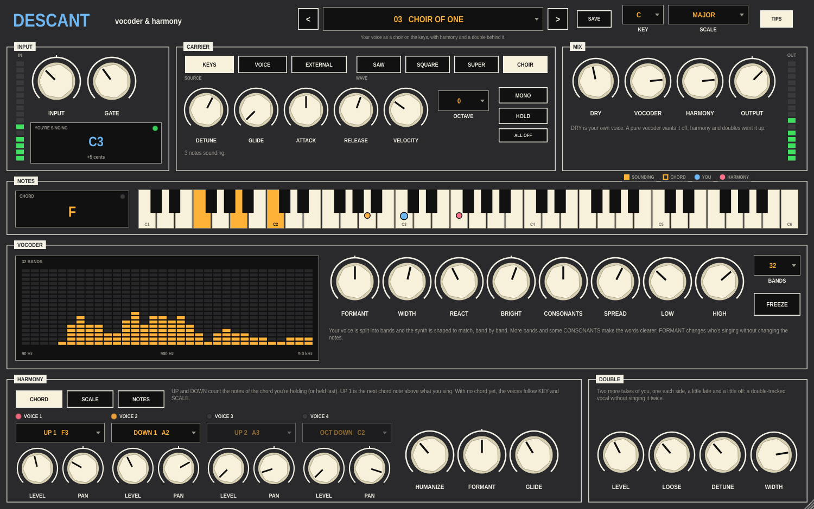

# Descant

A vocoder and vocal harmoniser for Ableton Live. Sing into a microphone and
play notes on a keyboard (or send chords from Posy): the vocoder puts your
words on the synth, and up to four harmony voices and a double sing along in
your own voice.

Put it on the audio track your microphone comes in on.



New to Descant? The [Getting started guide](docs/Descant-Getting-Started.pdf) (PDF)
wires up a microphone, a keyboard and Posy in Live and shows you round the panel.

## What's on the panel

**Header** — PRESET (click for the list, or step with `<` `>`; a `*` means
you've changed it), SAVE, KEY and SCALE, TIPS. KEY and SCALE are used by SCALE
harmony, by the VOICE carrier, and by CHORD harmony before any chord arrives.

**INPUT** — INPUT sets the microphone level. GATE shuts the microphone below a
level so room noise and headphone spill aren't vocoded or harmonised (all the
way down is off). The display shows the note it hears you singing and how many
cents off you are.

**CARRIER** — the synth your voice shapes.
- **KEYS** plays the notes sent to Descant over MIDI: one note or a chord.
- **VOICE** plays the note you're singing, snapped to KEY and SCALE. No keyboard needed.
- **EXTERNAL** uses another track, routed into Descant's sidechain.
- **SAW**, **SQUARE**, **SUPER** (five detuned saws) and **CHOIR** (three drifting saws per note).
- DETUNE, GLIDE, ATTACK, RELEASE, VELOCITY, OCTAVE.
- **MONO** plays one note at a time. **HOLD** keeps the chord after you let go;
  pressing new keys replaces it. **ALL OFF** lets go of everything. The sustain
  pedal works too.

**MIX** — DRY (your own voice), VOCODER, HARMONY and OUTPUT.

**NOTES** — the chord coming in, named, and a keyboard. Amber keys are
sounding; outlined keys are the chord CHORD harmony is using; the blue dot is
the note you're singing; the coloured dots are the harmony voices.

**VOCODER** — 8 to 40 BANDS between LOW and HIGH. The display shows your voice
band by band.
- **FORMANT** moves the shape of your voice without changing the notes: left is bigger and darker, right is smaller and brighter.
- **WIDTH** — narrow bands ring; wide bands are smooth.
- **REACT** — slow and smooth to fast and gritty.
- **BRIGHT** — tilts the bands darker or brighter.
- **CONSONANTS** — lets S and T sounds through and turns breath into noise, so the words are clear.
- **SPREAD** — alternate bands left and right.
- **FREEZE** — holds the vowel you're singing. Stop singing and play: the frozen vowel sings the keys.

Each carrier band is levelled before your voice shapes it, so the words stay
clear whatever wave and chord you play, and the vocoder sits at about your
voice's level whatever the band count.

**HARMONY** — four voices made from your own voice. They keep your vowels
(the shifting is pitch-synchronous, so you don't get chipmunks).
- **CHORD** — UP 1 is the next note of the held chord above what you sing, UP 2
  the one above that; DOWN counts down. The chord is remembered after you let
  go, so you can play a chord, take your hand off and sing.
- **SCALE** — fixed steps in KEY and SCALE: 3rd, 5th or 6th up; 3rd, 4th or 6th down.
- **NOTES** — each voice sings one of the held notes, lowest first. Hold a
  chord, sing anything, and your voice becomes the chord.
- OCT UP, OCT DOWN and UNISON work in CHORD and SCALE.
- Each voice has LEVEL (all the way down is off) and PAN. HUMANIZE makes them
  drift in pitch and timing and gives each its own tone, so they sound like
  different singers. FORMANT makes them all bigger or smaller. GLIDE sets how
  quickly they move to a new note.

**DOUBLE** — two more takes of you, one each side. LOOSE sets how late and
uneven, DETUNE how far off pitch, WIDTH how far apart.

Every knob, button and choice is a host parameter, so it can be automated or
MIDI-mapped in Live.

**Presets** — 20 factory presets. SAVE writes your own to
`~/Library/Application Support/Descant/Presets` (Windows `%APPDATA%\Descant\Presets`,
Linux `~/.config/Descant/Presets`); they show under YOURS in the list.

## Wiring it up in Live

1. **Microphone track.** An audio track with your microphone as its input and
   Monitor set to **In**. Put Descant on it. Use headphones, or the vocoder
   and harmonies will hear themselves through the speakers.
2. **Notes.** A MIDI track with your keyboard (an APC Key 25, say) as its
   input and Monitor set to **In**. Set its **MIDI To** to the microphone track,
   and the second chooser to **Descant**.
3. **With Posy.** Put Posy on that MIDI track. Posy's chords go where the
   track's MIDI goes, so they reach Descant. Play pads with one finger and sing.
   Posy's HOLD and arpeggiator work as they do with any instrument. The
   **Posy Pads** preset is a good start.

For EXTERNAL, open the sidechain section of Descant's device (the small
triangle at the top) and pick the track to shape.

Descant adds no latency to your dry voice or the vocoder. The harmony voices
come in about 10–25 ms behind you (less for higher voices), which is about
where a real backing singer sits; the doubles are later on purpose.

## Building

Needs CMake 3.22+ and a C++20 compiler. JUCE 8.0.9 is downloaded on first
configure.

```sh
cmake -B build -DCMAKE_BUILD_TYPE=Release
cmake --build build --config Release
ctest --test-dir build -C Release
```

Or double-click `build.command` in Finder.

The VST3 is copied to `~/Library/Audio/Plug-Ins/VST3` after each build on macOS
(`-DDESCANT_COPY_PLUGIN=OFF` to stop that). `-DDESCANT_BUILD_TOOLS=ON` also builds
`DescantSnapshot`, which runs Descant without a host, writes the panel to a PNG
and can render every factory preset to WAV files with a built-in synthetic
singer, or your own recording: `DescantSnapshot panel.png wavs [voice.wav]`.

The engine tests check the pitch tracker (82 Hz to 784 Hz at 44.1, 48 and
96 kHz), the shifter's pitch, level and lag for every interval from an octave
down to an octave up, the chord names and harmony rules, HOLD and the chord
memory, that the vocoder sings the key you hold at about your voice's level,
the sidechain and VOICE carriers, and every wave, band count and knob corner
staying finite and under full scale.

The [Build workflow](.github/workflows/build.yml) builds and tests on macOS,
Windows and Linux when you run it from the Actions tab. Run it on a version tag
(`v0.1.0`) to get a draft release with all three archives attached.

## Licence

Descant is released under the GNU AGPLv3. See [LICENSE](LICENSE).
